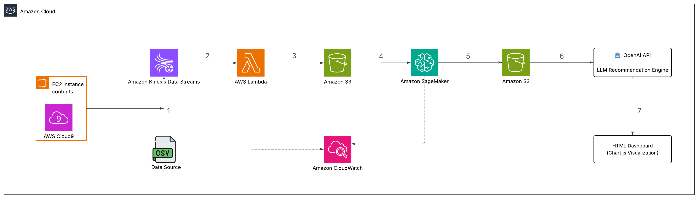
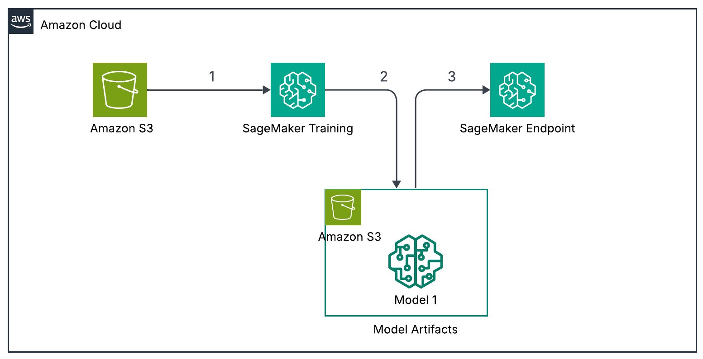
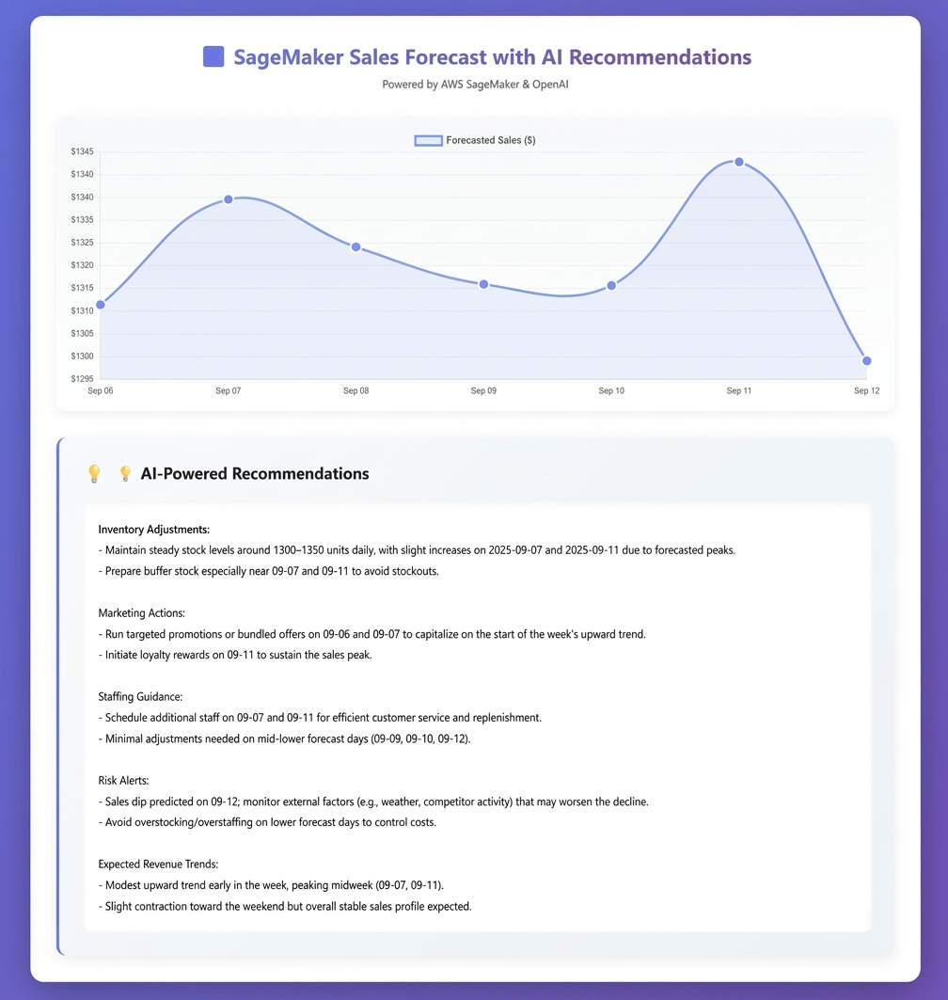

# AWS Retail ML Sales Forecasting

> **Academic project** developed over two months, from October 2025 to November 2025.

## About the Project

This cloud-based solution forecasts retail sales using historical data and **Facebook Prophet**, a powerful time-series forecasting model. It enables accurate short-term predictions, helps optimize inventory levels, supports promo planning, and enhances decision-making by providing clear, data-driven sales insights.

It is deployed on **Amazon SageMaker**, with **OpenAI**-generated business recommendations shown on a **Chart.js** dashboard.

## Architecture

```
CSV (Kaggle) -> Cloud9 (EC2) -> Kinesis Data Streams -> Lambda -> S3 (processed/)
   -> SageMaker (Prophet training + endpoint) -> S3 (dashboard/forecast.json)
   -> OpenAI API (recommendations) -> HTML dashboard (Chart.js)
CloudWatch monitors Lambda and SageMaker.
```



### Model Pipeline: Architecture



## Data

**[Online Sales Dataset](https://www.kaggle.com/datasets/yusufdelikkaya/online-sales-dataset)** (Kaggle, by Yusuf Delikkaya) - *Online Shopping Patterns and Retail Performance Dataset*.

The dataset contains anonymized online sales transactions, covering product purchases, customer details and order characteristics. It can be used to analyze sales trends, customer purchasing behavior and order management in e-commerce or retail, to understand the impact of discounts, payment methods and shipment providers on sales performance, and to optimize inventory by studying product demand.

Columns include invoice number, stock code, description, quantity, invoice date, unit price, customer ID, country, discount and payment method, among others (see the [Kaggle page](https://www.kaggle.com/datasets/yusufdelikkaya/online-sales-dataset) for the full feature list). Raw data is not included in this repository; download it from Kaggle.

## Data Preparation & Storage

**Data cleaning and preparation**
- Removed irrelevant or redundant columns to reduce noise.
- Standardized column names for clarity and easier modeling.
- 49,782 rows before cleaning, 47,293 after.

**Columns kept**

| Column | Why |
|---|---|
| `date` | Required for the model to index the time series |
| `product_category` | Allows forecasting per product type if needed |
| `quantity` | Historical quantity of sales per date |
| `price_per_unit` | Used to calculate revenue or trends |

**Forecasting based on:** historical sales per date. The forecast target is daily sales = `quantity x price_per_unit`.

The cleaned CSV is uploaded to S3 (`processed/`) and streamed row by row through Kinesis and Lambda (see the pipeline steps below).

## Repository layout

| Path | Purpose |
|---|---|
| `lambda/lambda_function.py` | Kinesis-triggered Lambda: decodes records and writes CSV files to S3 |
| `src/1_Set_up_bucket.py` | Region, role, bucket and S3 path setup |
| `src/2_clean_dataset.py` | Local cleaning and column standardization (reconstructed) |
| `src/3_upload_cleaned_dataset_to_S3.py` | Upload cleaned CSV to `processed/` |
| `src/4_send_to_kinesis.py` | Stream each CSV row to Kinesis as JSON |
| `src/5_sagemaker_training.py` | Train Prophet, package `.tar.gz`, upload to S3 |
| `src/code/inference.py` | SageMaker inference hooks (reconstructed) |
| `src/7_deployment.py` | Deploy the real-time endpoint (reconstructed) |
| `src/sagemaker_forecast.py`, `src/upload_forecast.py` | Call the endpoint, save and upload `forecast.json` |
| `src/recommend_openai.py`, `src/test_recommendations.py` | LLM recommendations |
| `src/visualisation.py` | Build the Chart.js HTML dashboard (reconstructed) |

## Pipeline steps

Screenshots are stored in [docs/screenshots/](docs/screenshots/); file names start with the step number.

| Step | What | Details |
|---|---|---|
| 1 | **Cloud9** environment | New EC2, t2.micro, Amazon Linux 2023 ([create](docs/screenshots/step-01a-cloud9-create-environment.png), [created](docs/screenshots/step-01b-cloud9-environment-created.png)) |
| 2 | **S3** bucket | `<your-bucket-name>` (e.g. us-east-1, ACLs disabled) ([create](docs/screenshots/step-02a-s3-create-bucket.png), [created](docs/screenshots/step-02b-s3-bucket-created.png)) |
| 3 | **Kinesis** data stream | `<your-kinesis-stream>`, on-demand capacity, 1-day retention ([screenshot](docs/screenshots/step-03-kinesis-stream.png)) |
| 4 | **Lambda** | `<your-lambda-name>` (Python 3.12, x86_64), Kinesis trigger (batch size 10, starting position Latest) ([create](docs/screenshots/step-04a-lambda-create-function.png), [trigger](docs/screenshots/step-04b-lambda-add-trigger.png), [overview](docs/screenshots/step-04c-lambda-function-overview.png), [code](docs/screenshots/step-04d-lambda-code.png)) |
| - | **Data preparation and ingestion** (scripts `1` to `4` in `src/`) | Setup, clean, upload to S3, stream to Kinesis, Lambda writes CSVs to `processed/` ([1 set up bucket](docs/screenshots/prep-1-set-up-bucket.png), [2 clean dataset](docs/screenshots/prep-2-clean-dataset.png), [3 upload to S3](docs/screenshots/prep-3a-upload-to-s3-code.png), [S3 result](docs/screenshots/prep-3b-s3-processed-folder.png), [4 send to Kinesis](docs/screenshots/prep-4a-send-to-kinesis-code.png), [Kinesis records](docs/screenshots/prep-4b-kinesis-records.png), [Lambda output in S3](docs/screenshots/prep-5-lambda-output-in-s3.png)) |
| 5 | **SageMaker** notebook | `ml.t3.medium` with an execution role ([screenshot](docs/screenshots/step-05-sagemaker-notebook.png)) |
| 6 | **Training** | Train Prophet (locally or on SageMaker), save the model and package it as `prophet_model.tar.gz`, upload it to `s3://<bucket>/pipeline/model/`, then prepare it for the endpoint ([training](docs/screenshots/step-06a-training.png), [artifact in S3](docs/screenshots/step-06b-model-artifact-in-s3.png)) |
| 7 | **Endpoint** | Inference code defines how the model receives inputs and generates predictions; deployment exposes it through a SageMaker endpoint `<your-endpoint-name>` for real-time forecasting ([screenshot](docs/screenshots/step-07-endpoint.png)) |
| 8 | **Forecast** | SageMaker forecasts saved locally as JSON, then uploaded to `s3://<bucket>/dashboard/forecast.json` for easy access ([screenshot](docs/screenshots/step-08-forecast-json.png)) |
| 9 | **Recommendations** | OpenAI `gpt-4.1-mini` generates AI-powered recommendations from the forecast data ([screenshot](docs/screenshots/step-09-recommendations.png)) |
| 10 | **Dashboard** | HTML dashboard combining sales trends and recommendations, drawn with Chart.js ([screenshot](docs/screenshots/step-10-dashboard.png)) |

Final dashboard:



## Model Development & Deployment

**Chosen model: Prophet**

- **What it is:** a time-series forecasting model that handles trends and seasonality (weekly and yearly).
- **Why we chose it:**
  - Works well with daily sales data.
  - Handles missing dates and irregular intervals.
  - Simple to implement.
  - Provides reliable forecasts for short- and medium-term retail planning.
- **Forecasting target:** daily sales (`quantity x price_per_unit`) per product category.

## Running it

```bash
pip install -r requirements.txt
export BUCKET=<your-bucket> SAGEMAKER_ROLE=<role-arn> OPENAI_API_KEY=<key>
# optional: AWS_REGION, STREAM_NAME, ENDPOINT_NAME (see src/config.py)
cd src
python 2_clean_dataset.py <raw.csv>
python 3_upload_cleaned_dataset_to_S3.py
python 4_send_to_kinesis.py
python 5_sagemaker_training.py
python 7_deployment.py
python upload_forecast.py
python visualisation.py
```
 
## Deployment difficulties

| | |
|---|---|
| **Problem** | The model was first trained and deployed in the SageMaker **SKLearn** container. |
| **Issues** | Package dependency conflicts (`pystan`, required by Prophet). The SKLearn container offered limited flexibility for custom inference scripts. |
| **Solution** | Switched to the **PyTorch** container: full control over the model definition and inference, and easier packaging of the model artifact (`.tar.gz`). |
| **Outcome** | The model deployed successfully as a cloud-ready endpoint, with fewer deployment errors and better scalability and maintainability. |

## Conclusion

The project successfully implemented an end-to-end sales forecasting and recommendation system by combining AWS SageMaker for modeling and deployment with OpenAI for AI-powered recommendations, delivering actionable insights through automated forecasting and interactive visualizations.

## Implementation Notes

Some AWS services and features were not accessible in my environment (e.g. due to account or permission restrictions). Where this was the case, I used accessible alternatives that serve the same role in the pipeline,
so the overall architecture and data flow are unchanged.
